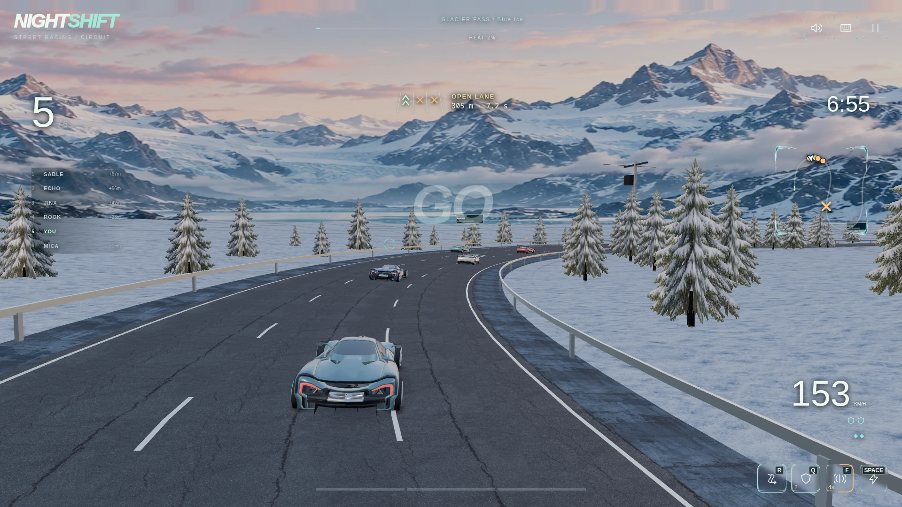
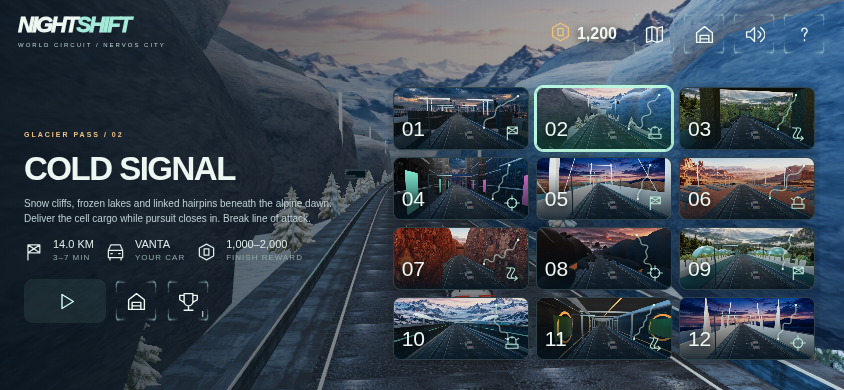
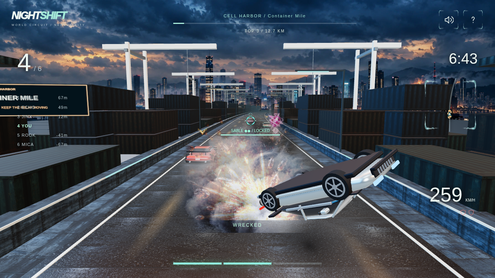

# NIGHTSHIFT — World Circuit

A browser racing game from UTXOPlay: twelve distinct roads, six cars, five rival drivers, vehicle upgrades and a signed solo career.

[Play on UTXOPlay](https://store.utxoplay.io/games/nightshift/) · [Game design](docs/nightshift-world-circuit.md) · [Verification and versioning](docs/verification.md) · [Roadblocks and recovery V10](docs/nightshift-v10.md) · [District structure 9.6](docs/nightshift-v96.md) · [Materials and lighting 9.5](docs/nightshift-v95.md) · [Career and garage 9.4](docs/nightshift-v94.md) · [Districts and continuous scenery 9.3](docs/nightshift-v93.md) · [Engine and interface 9.2](docs/nightshift-v92.md) · [Motion presentation 9.1](docs/nightshift-v91.md) · [Circuit handling V9](docs/nightshift-v9.md) · [Combat Season 8](docs/nightshift-v8.md) · [V7 audit](docs/combat-design-audit.md)

Current product status: **playable solo arcade prototype**. See the [9.4 completion audit and NFS alignment gates](docs/completion-audit-v94.md) for implemented mechanics, measured limitations and the next acceptance criteria.



## Race the circuit

- Twelve environments, from Nervos Harbour and Glacier Pass to the Reactor Loop and Dawn Skyway, each with its own course, scenery, preview thumbnail and HUD minimap.
- Sprint podiums, pursuit escape, drift challenges and interception contracts. Successful races last 3–7 active minutes.
- Six cars, earned Relay Credits and three upgrade tracks per vehicle.
- Persistent opponents, slipstreaming, nitrous, lock-on EMP, shockwave, rear mines and a timed defensive jammer.
- Generated transparent markers and effects for collisions, attacks, shields, counters, disabled rivals and fatal rollovers.
- Keyboard, pointer drag and mobile thumb-stick controls. Landscape play, safe-area controls, reduced motion, bounded rendering resolution and layouts through 3840×2160.

Version 10 adds fixed, readable roadblock encounters, shared static contacts for traffic/rivals, lane/minimap guidance and latched touch reverse. Unfinished V9/V8 events keep their original executor until finished or explicitly replaced; verified careers carry forward into new V10 events.

Version 9 introduced continuous winding roads, elevation and banking, swept contacts, mass-weighted impulses, braking/reverse and Colemak/custom controls. Verified V8 careers carry forward as a signed origin. An unfinished V8 event retains its original executor until finished or explicitly replaced.

This release is a **solo racing career**. Live multiplayer is future work. The fictional Nervos relay setting and Relay Credits are off-chain game content; Myelin provides deterministic host replay, not CKB settlement.

## Run locally

Use Node.js 22 or later and Rust. The native RocksDB dependencies require Clang/libclang, pkg-config and protoc. On Debian/Ubuntu:

```sh
sudo apt-get install clang libclang-dev pkg-config protobuf-compiler
npm ci
npm run build:native
npm run build:native:legacy
npm run build:native:previous
npm run dev
```

Open **http://127.0.0.1:8898/games/nightshift/**. `npm run dev` builds the browser and creates a local development token in ignored `data/development-token`. Keep this file and the data directory between restarts if you want to retain your local career. The native service listens only on loopback port 8798.

For a production process, build once and supply a stable server-only token:

```sh
npm run build
export RUNTIME_TOKEN="$(openssl rand -hex 32)"
export GAME_ORIGIN="http://127.0.0.1:8898"
npm start
```

Persist the token in your deployment's secret storage and reuse it across restarts. Keep native ports private. `WEB_PORT`, `RUNTIME_PORT`, `BIND`, `DATA_DIR`, `RUNTIME_BINARY` and `RUNTIME_URL` can be configured through the environment. `RUNTIME_URL` uses an already-running private native service.

## Controls

| Action | QWERTY | Colemak / DH | Touch |
| --- | --- | --- | --- |
| Steer | A / D | A / S | Thumb stick |
| Drift / brake | S | R | Pull stick down while steering / straight |
| Reverse | Z | Z | Pull straight down after stopping |
| Nitrous | Space | Space | Lightning icon |
| Equipped weapon | E | F | Weapon icon |
| Defensive jammer | Q | Q | Shield icon |
| Pause | P / Escape | P / Escape | Pause icon |

The keyboard icon selects a preset or rebinds every action. HUD labels follow the saved bindings. Left/right/down arrows remain driving fallbacks. Layout detection is used where the browser supports it; the manual preset works everywhere.



## Verify

```sh
npm test
npm run build
npm run check:release
npm run test:native
npm run test:conformance
npm run build:native:legacy
npm run test:replay
```

`test:conformance` compares JavaScript and Rust across all twelve tracks and a career that earns and buys all six cars. `test:replay` checks signed rewards, purchases, restart recovery and rejection by the retained V8 verifier. It requires both native binaries. The legacy source is included only for replay compatibility; the web host serves V9 and bridges unfinished V8 events.

Browser checks use a separate local review server and a fresh data directory:

```sh
npx playwright install chromium
node tools/nightshift9-server.mjs
# In another terminal, while the review server is running:
npm run test:browser
npm run test:maps
npm run test:combat
npm run test:performance
```

The review server runs at `http://127.0.0.1:8899`; reports go under ignored `artifacts/`. The purchase acceptance test expects a new career, so use a fresh review data directory when repeating it. `DRIFT_ORIGIN`, `DRIFT_OUT`, `DRIFT_BIN` and `DRIFT_BUILD_ROOT` override test locations. Public UTXOPlay review is opt-in with `DRIFT_AUTH=1`; it uses a fresh unfunded QA wallet in memory and sends no transaction.

GitHub Actions runs browser-source checks, native tests, conformance and signed replay. Physical Android/iOS testing is separate from the included Chromium touch emulation.

## Docker

```sh
export RUNTIME_TOKEN="$(openssl rand -hex 32)"
export GAME_ORIGIN="http://localhost:8898"
docker compose -f deploy/compose.yml up --build -d
```

The Compose service binds the web port to local loopback and persists V9 and legacy V8 state in separate named volumes. Put your HTTPS reverse proxy in front of it and set `GAME_ORIGIN` to the public origin. UTXOPlay gateways authenticate through `X-Runtime-Token` and `X-UTXOPlay-Account`; browser guests have separate identities. The canonical public game path is `/games/nightshift/`.

## Source and artwork

The current release was extracted from the shared [UTXOPlay/myelin-arcade](https://github.com/UTXOPlay/myelin-arcade) workspace. Native profile-bound files and the 31 audited browser release files are preserved; portable tooling and standalone packaging were added here. Future rule changes must use a new application profile and must not reinterpret old signed careers.

- `games/nightshift-v9/native/`: deterministic Rust simulation and Myelin sessions.
- `games/nightshift-v9/web/`: browser application and mobile orientation gate.
- `games/arcade/web/nightshift9-*`: renderer, mirrored rules, controls and audio.
- `games/arcade/web/art/nightshift/`: generated artwork and actual map thumbnails.
- `host/`: authenticated standalone host and UTXOPlay gateway integration.
- `games/nightshift-v8/native/`: retained V8 verifier and career origin adapter. V7 and V6 sources are also preserved.

Built-in imagegen prompt records: [combat/UI](docs/nightshift-combat-art.json), [world textures and scenery](docs/nightshift-world-art.json), [career art](docs/nightshift-crew-art.json), [relay materials](docs/nightshift-relay-art.json), and [original city assets](docs/nightshift-art.json). Source PNG names are provenance references; all runtime assets are checked in as WebP. Generated renderer bundles, build artifacts, private keys, runtime databases and local credentials are excluded.



MIT-licensed source; see [LICENSE](LICENSE) and [NOTICE](NOTICE.md) for retained attribution. Racing research and GitHub references are linked in the [career design](docs/nightshift-crew-circuit.md).
