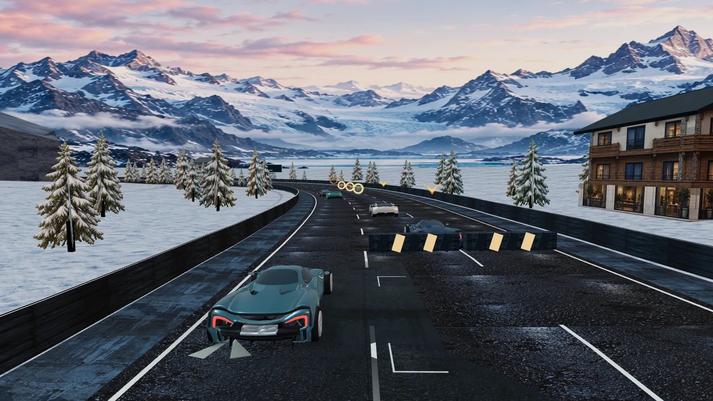

# NIGHTSHIFT 9.4 — product completion and NFS alignment audit

Audited 30 October 2026. The live catalog and entry point report 9.4.0; all 94 served browser files match the release manifest. The public session reports the retained V9 application profile and verifies its signed replay. Runtime browser source is `fa64befa5256c9e6902e07cb56e0ccaba47751ba`; the audited documentation head is `a5ac63aa64566b213416c9874589cbd1c00cb4f9`.

**Verdict: a playable solo arcade prototype, with a substantially stronger verification foundation than its product depth. Internal maturity score: 40/100.** This is a rubric for a complete NFS-inspired browser racer, not a percentage of EA's assets/features or an estimate of remaining labor. No racing rules, deployed assets or production configuration were changed by this audit.

9.4 improved discoverability, receipts, car comparison and career presentation. Its four discipline filters expose existing race types. Reputation ranks and eight milestones summarize saved values; they do not unlock events, award extra currency or implement a new career structure. Release validation demonstrated that implemented behavior works and replays consistently. It did not establish that the overall game was complete or comparably enjoyable to NFS.

## Reference scope

The principal reference is **NFS Unbound's base single-player experience**: handling choices, car development, purposeful events and career stakes. [Official features](https://www.ea.com/en/games/need-for-speed/need-for-speed-unbound/features), [single-player introduction](https://forums.ea.com/discussions/need-for-speed-unbound-discussion-en/under-the-hood-welcome-to-need-for-speed%E2%84%A2-unbound/9397714), [handling/customization article](https://forums.ea.com/discussions/need-for-speed-unbound-discussion-en/under-the-hood-show-up-and-show-off/9398276) and [accessibility/controls](https://www.ea.com/able/resources/need-for-speed-unbound?isLocalized=true) define the comparison. [The publisher's risk/reward trailer](https://www.youtube.com/watch?v=D5aU75h7Yzs) supports the importance of earning, spending and choosing risks within a career.

[Hot Pursuit Remastered's official manual](https://eaassets-a.akamaihd.net/eahelp/manuals/nfs-hp-remastered-switch-en.pdf) is a secondary reference for equipment, readable pursuit and counterplay. Unbound's normal single-player races are not being described as EMP/mine battles. Post-launch online Drift/Drag/Lockdown content is outside the single-player score. The proposed physics and AI architecture below is our design recommendation, not a claim about EA's proprietary implementation.

## Completion rubric

0 = absent; 1 = prototype; 2 = functional but limited; 3 = validated within this browser product's scope; 4 = meets the proposed reference acceptance criteria. Scores are engineering/design judgments informed by the evidence below.

| Dimension | Weight | Maturity / 4 | Current state and gap |
| --- | ---: | ---: | --- |
| Driving and contacts | 25 | 1 | Steering, brake/drift, reverse, boost and integer swept contacts work. Forward motion is automatic and road-relative; independent throttle, a developed traction/yaw model and actor-wide collision handling are missing. |
| AI and combat | 15 | 2 | Sustained proximity, telegraphed attacks, guards, recovery and route-gated unique targets work. Planning is largely three-lane cost selection and player-relative pace; AI has different obstacle consequences. |
| Events and replay value | 15 | 2 | Twelve real bend sequences, four objective types and valid 3–7 minute finishes. Skill objectives often resolve well before the finish; laps, time trials, persistent personal records and ghosts are missing. |
| Career and economy | 15 | 2 | Earned currency, six purchases, three upgrade axes and signed persistence work. Ranks/milestones have no progression effects, builds mostly improve all stats, and there is no qualifying/career arc or risk/banking loop. |
| World and course interaction | 10 | 1 | Twelve biome identities and continuous road/ground rendering. Gameplay remains on one fixed corridor without route junctions, shortcuts or a connected driveable world. |
| Art, animation and audio | 10 | 1 | Licensed source geometry, shared facade assets, pooled effects and event-driven motion. Two base car bodies, repeated prop silhouettes, flat distant backplates and a generic synthesized sound layer limit identity and coherence. |
| Controls, onboarding and UX | 5 | 2 | Colemak/custom bindings, joystick, landscape gating, map previews and icon accessibility work. Interactive teaching, gamepad support and physical-phone validation remain incomplete. |
| Engineering and verification | 5 | 3 | Native/browser agreement, signed saves, profile retention, bounded rendering and release identity have evidence. Long-session, real-device and real-time multiplayer operation are not established. |

Weighted score = sum(weight × maturity / 4) = **40/100**. Multiplayer is excluded from this solo score. The current host explicitly has `rooms:false` and `socket:false` in [host.json](../games/nightshift-v9/host.json).

## Evidence collected in this audit

[Machine-readable findings](completion-audit-v94.json) retain the aggregates and limitations.

- 432 executions until win/loss: the existing 144-run Street matrix plus a 288-run matrix across all twelve maps, three difficulties, four weapon policies and two race IDs. There are **336 distinct map/difficulty/policy/race-ID cases**, because 96 configurations repeat between matrices.
- 3,147,658 active simulation ticks. **54 full races** were compared field-for-field with the retained native executable. A separate ordinary-input roadblock prefix and continuation were also native-verified.
- Completed runs in the extended sample lasted **227.0–398.1 seconds**, within the requested 3–7 active minutes.
- Fresh live browser observation: 12 events, six selectable builds, two source bodies, eight milestones, ordinary keyboard driving, native profile and signed replay; no page errors. Actual served asset bytes were independently hashed over public HTTPS.

One heuristic controller supplies these policies. These are not human win rates or optimal weapon comparisons. Spatial-overlap probes use the current player collision envelope and exclude AI within 15 m of the player; their episode counts are diagnostic, not mesh-confirmed crash totals. Edited-state isolation probes are explicitly synthetic. The browser's verified local asset cache makes this unsuitable for cold-start network claims. No new physical-phone, long thermal, multiplayer/load or hands-on NFS side-by-side test was performed.

## Findings that block a complete-racer acceptance

### 1. The driving model still has the structure of a road runner

[Rules lines 193–199](../games/arcade/web/nightshift9-rules.mjs#L193) update lateral position and distance against a prescribed road. Forward target speed is chosen automatically unless braking or reversing. In a normal zero-input 150-tick probe, the car travels **223.8 m in five seconds and displays 175 km/h**. The fresh live observation also records 150 ticks, 224.4 m and 175 km/h without throttle input.

There is real contact work: swept boxes, mass sharing, friction impulses and collision yaw. The gap is a coherent driving loop in which acceleration, braking, steering, grip loss and exit speed interact. A mobile auto-throttle assist can remain useful, but the present forced model sets a low ceiling for braking-point and corner-exit skill. Camera roll, wheel motion and more particles do not add that control model.

### 2. AI can traverse an intact roadblock that physically stops the player

[Contact handling](../games/arcade/web/nightshift9-contact.mjs#L31) resolves the player against rivals and bodies. AI avoidance in [rules lines 204–219](../games/arcade/web/nightshift9-rules.mjs#L204) chooses lanes and caps desired speed, without an equivalent AI-versus-roadblock/traffic solver. The native [contact function](../games/nightshift-v9/native/src/game.rs#L1464) follows the same player-centered structure.

This is reproduced by **ordinary inputs**, not only edited state. In Cold Signal, Street difficulty, no-fire, race ID 1, rival 2 and roadblock 12 share lateral coordinate 1000. At tick 282, the rival is at distance 4713 and the obstacle at 4729; at ticks 290 and 298, the rival reaches 4785 and 4863 while the obstacle remains at 4729. Its HP stays 2 and stun stays 0. The player is 43 m away at the first snapshot. The [saved prefix](audit/roadblock-prefix-v94.json) and continuation match native execution.



All 72 extended escape runs contain at least one approximate AI/roadblock overlap episode away from the player. This diagnostic does not establish how every overlap looks, but the verified prefix confirms the missing physical consequence in a normal run. A separate synthetic obstacle isolation ends an unarmored player's run after five ticks, while an AI passes the obstacle without equivalent response. Fair collision handling is a higher priority than adjusting an opponent speed number.

### 3. The requested race length lacks sustained mode-specific purpose

In the **61 winning Style samples**, median target attainment is 55.2 seconds; median time remaining after attainment is **210.7 seconds**. In the **25 winning Intercept samples**, median remaining time after completing all targets is **120.1 seconds**. These are separate medians, not subtractable median timestamps.

Traffic, rivals, score and finish position still matter afterward, and extra style can increase the capped style payout. The problem is that a mode's defining objective often gives way to the same generic drive-to-finish loop. Preserve the requested 3–7 minutes and give the remaining sections meaningful skill scoring, escalating encounters or visible reward decisions.

### 4. Pursuit is a pressure rule, not a police simulation

[Pursuit rules](../games/arcade/web/nightshift9-rules.mjs#L223) primarily change a scalar from speed, boost, close passes, hits and collisions, with periodically spawned roadblocks. There are no native police actors, search state, line-of-sight escape, unit escalation or safehouse/banking transition. The [rendered pursuer](../games/arcade/web/nightshift9-renderer.mjs#L120) is positioned from the pressure value, rather than being an independent rule actor.

The escape event is functional. Describing it as equivalent to a developed NFS chase would overstate its implementation.

### 5. Medals and records do not consistently reward the advertised discipline

The [native finish and medal rules](../games/nightshift-v9/native/src/game.rs#L1192) check the event objective, then grade every successful event by final race position. Style volume/quality does not determine the Style medal. The sample contains successful style runs with more style and a lower medal because of placement; for example, Green Line/Elite has 4,656 style at fourth place for bronze.

The career persists best medals, not per-event personal-best times, sector deltas or replayable ghosts. The final six-driver table is a real solo classification, not an online leaderboard. Mode-specific grading and verified personal improvement would add much more replay value than another presentation-only rank.

### 6. The career has accounting but little progression structure

[Career read models](../games/arcade/web/nightshift9-career.mjs#L4) derive badges and goals. [Race setup](../games/arcade/web/nightshift9-rules.mjs#L172) admits every event at every reputation; ownership is the car admission gate. The three tuning axes provide positive increments and have no class budget or competing setup choices. Rank or milestone completion does not affect rules.

Buying all non-starter cars costs 15,600 credits; fully tuning six cars costs another 64,800. After the 1,200-credit start, that is 79,200 credits. The sampled Street-win median is 1,806 credits: roughly 44 winning payouts at that constant median. This is a budget illustration, not measured career completion time. The missing element is a sequence of meaningful qualifiers, build decisions and new contracts across that investment.

### 7. Vehicle and scene variety is narrower than the labels suggest

[The fleet](../games/arcade/web/nightshift9-fleet.mjs#L7) really has six paint/kit/stat identities, but derives geometry from **two base bodies**. Calling it six entirely different vehicle models would be inaccurate. The cooking path removes UV attributes and combines surfaces into shared color/material data, which limits hero material detail. The [audio layer](../games/arcade/web/nightshift9-audio.mjs#L1) uses shared oscillators/noise; it has no vehicle-specific recording library or developed environment/music mix.

Fresh Harbour frames show repeated large box/crane silhouettes and very dark foreground masses against a bright, detailed static backplate. Those are art-direction observations, not proof of missing geometry. Eight facade families and 24 composition slots improve reuse but do not guarantee authored landmarks or distinct visual pacing. Wet/snow visual treatments have no corresponding surface-grip parameter in the current driving rules. The skyline remains a distant backplate after its seam correction.

### 8. Production evidence and future multiplayer have explicit limits

The release's two final performance samples were 20 seconds each: desktop high quality median/p10 **59/45 FPS**, mobile-emulated low quality **60/59 FPS**. They do not prove sustained physical-phone performance, a 4K driving budget or an improvement against a matched old-version baseline. Existing resize, landscape, input-transform and save checks remain valuable and should be retained.

The host currently provides identity, personal saves and replay validation. Match admission, an authoritative shared clock, actor input ordering, remote interpolation/reconciliation, reconnect behavior, matchmaking and exactly-once match rewards are absent. Myelin here is off-chain host replay, not CKB settlement.

## Improvements that are real and should be retained

The current audit does not repeat the old V7 diagnosis that racers rarely meet. In the separate 144-run Street sample, race/no-fire spends about **86% of ticks within ±90 m of an unfinished rival**, and wins **8/9** runs. This geometric proximity is not the same as continuous meaningful combat, but it is a substantial change from the old audit. The extended Street sample averages about 11.4 player-targeted attack windups per attempt; all-enemy windups must not be confused with attacks on the player.

Attack cancellation, guard expiry, recovery protection and route-gated unique targets are real. Street Intercept outcomes under the existing controller are EMP **8/9**, Shockwave **7/9**, Mine **2/9**. Mines also defend race position successfully. This indicates an event/loadout/controller interaction to investigate, not proof that mines should simply receive a damage buff: the controller is not a specialist mine player.

The signed earned economy, car purchases, exact upgrade previews, readable receipts, Colemak/remapping, landscape joystick, resolution cap, resource pooling and native/browser replay foundation are also real completed work. They support the next game-design stage.

## Alignment roadmap and acceptance gates

| Order | Deliverable | Acceptance criteria |
| --- | --- | --- |
| 1 | Driving and shared contact kernel | Independent throttle/brake/steer with optional auto-throttle; speed-dependent grip/yaw and meaningful entry/apex/exit choices. Player, rivals and traffic share collision consequences. The verified roadblock prefix must stop reproducing uninterrupted wall passage under the new rules. |
| 2 | AI and three benchmark courses | AI uses vehicle capabilities and route look-ahead, brake points, overtake/defense decisions and bounded catch-up assistance. Preserve twelve maps; develop Harbour, Glacier and Neon into authored examples with distinct lines, encounter cadence and recovery paths. Paired build tests demonstrate a useful upgrade payoff. |
| 3 | Event and career loop | Keep successful stages within 3–7 minutes. Add real circuit/time-trial variants, discipline-specific medals, signed personal records and a ghost/replay path. Career qualifiers or contracts open new decisions; class budgets and parts create tradeoffs. Objective completion leaves a visible reason to perform through the finish. |
| 4 | Art/audio and device sign-off | Distinct hero-car silhouettes and appropriate material detail, coherent near/mid/far lighting, varied local landmarks and car-specific audio. Use image generation for textures/signage/VFX assets. Validate frame pacing, memory and thermals in long sessions on real target phones, plus first-time-player control discovery. |
| Later, separate scope | Real-time multiplayer | Define authoritative timing, rooms/admission, ordered inputs, reconciliation, disconnects, competitive classes and exactly-once rewards before claiming online race support. |

Any driving, contact, event, reward, medal or career rule change requires **a new application profile with matching native/browser replay**. Retain the current V9 verifier and save namespace; preserve existing credits, ownership and historical records through an explicit, tested migration. Do not reinterpret current signed tapes under new rules.

## Reproduce

```sh
ARCADE_BIN=artifacts/circuit-v9/portable-target/release/myelin-nightshift-v9 node tools/nightshift9-balance.mjs
ARCADE_BIN=artifacts/circuit-v9/portable-target/release/myelin-nightshift-v9 node tools/nightshift9-completion-audit.mjs
DRIFT_ORIGIN=https://store.utxoplay.io node tools/cached-browser-review.mjs tools/nightshift9-completion-review.mjs
DRIFT_ORIGIN=https://store.utxoplay.io node tools/cached-browser-review.mjs tools/nightshift9-completion-scene.mjs
```

For a different platform, use a locally built compatible V9 executable via `ARCADE_BIN`; binary bytes may differ while application profile and replay results must agree. The live review creates a fresh unfunded QA identity and uses normal native actions. It does not use an existing player's account. Full raw matrices remain under ignored `artifacts/completion-audit-v94`; the committed JSON retains aggregates, limits and evidence links.
