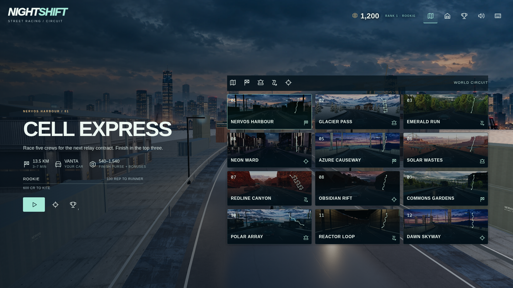
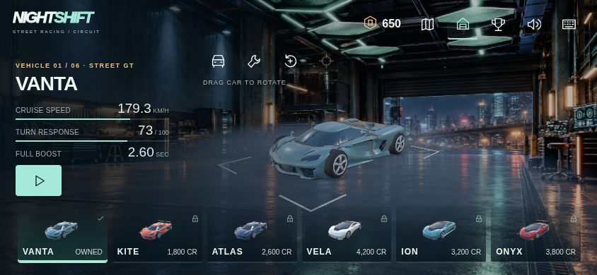
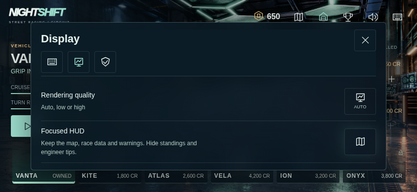

# NIGHTSHIFT menu and interface review — 10.0.3

## Research and design decisions

The references are primary publisher/developer documentation rather than unverified UI galleries. [GT7's World Map manual](https://www.gran-turismo.com/gb/gt7/manual/gtworld/03) separates destinations and explains the current goal; its [GT Menu documentation](https://www.gran-turismo.com/us/gt7/manual/option/01) separates profile, settings and contextual options. [Xbox navigation guidance](https://learn.microsoft.com/en-us/xbox/accessibility/xbox-accessibility-guidelines/112) emphasizes consistent component order, meaningful directional focus, reflow and a persistent route back. [EA's Unbound accessibility reference](https://www.ea.com/able/resources/need-for-speed-unbound?isLocalized=true) demonstrates grouped settings and independent HUD/effect choices. Its visual-effects settings image was inspected as a reference; no EA image or code is included in NIGHTSHIFT.

The useful lesson is hierarchy and dependable interaction, not reproducing every console panel. NIGHTSHIFT keeps its full-viewport 3D scene, English interface and icon-led controls. Essential destinations stay in one location. A card explains the place it represents. Secondary information moves behind a contextual view instead of covering the vehicle. Hover/focus labels explain an icon without adding a permanent row of instructions.

| Earlier interface | 10.0.3 change |
| --- | --- |
| Events/Garage/Driver icons disappeared or shifted with the page. | All three destinations stay visible in the same relative positions in menus. A current-page marker and accessible page state establish location. |
| Small screens compressed twelve numbered map tiles into one view. | Scenic cards show district names, route outlines and discipline icons. Landscape phones scroll larger cards; all twelve remain reachable through touch, keyboard or gamepad. |
| Selecting a card rebuilt the DOM and lost focus. | Stable focus keys, selection state and per-view scroll memory survive rebuilding, filters, car changes and asynchronous purchases. State is captured before a page changes its CSS layout. |
| The tuning grid covered the vehicle preview. | A six-car filmstrip sits below the scene. Showroom mode clears the central vehicle area; tuning uses a bounded side column with its own vertical scroll. Native costs, previewed benefits and availability remain authoritative. |
| Controls, help, rendering and replay exports shared one long drawer. | Controls, Display and Records use three icon tabs. Reset-binding controls only appear in Controls. Rendering and optional focused HUD live in Display; career verification/export live in Records. |
| Decorative frame textures and duplicate prose competed with the main choice. | Navigation/action buttons use restrained borders and selection marks. Context labels appear on hover or focus, including gamepad focus. Redundant garage instructions are removed. |

Keyboard arrows reuse the spatial-navigation function used by gamepads. Native text/select editing, control rebinding, the vehicle selector's existing arrow handling and race controls keep their own behavior. Focus follows visible geometry when a layout changes. Tab/Enter and existing Colemak/custom bindings remain available.

Focused HUD is an optional saved display preference. It hides the live standings list and engineer prose while retaining place, time, speed, charges/equipment, minimap, incoming attacks and roadblock warnings. It does not change AI, scoring, physics or the information generated by the native game. The practice boost prompt also now follows the real 300-charge or nitro requirement.

## Layout and performance contract

Every menu/control remains inside `#game`; no outer application toolbar or nested game frame is added. The canvas keeps its original viewport geometry, inverse pointer transform, bounded backing resolution and game-owned portrait gate. Existing vehicle, environment, route-preview and audio assets are reused. No new raster textures, materials, lights or render passes are added. Reduced motion disables the new thumbnail transitions. The source build retains all eighteen V10 native source bindings, the exact rule profile and the three executable pins.

Map browsing uses clipped scrolling deliberately. Tests therefore check the viewport bounds of the scrolling region and individually reveal each event, instead of requiring all twelve unscrolled card rectangles to fit a phone at once. The old checks for purchases, rewards, race length, touch input, native replay and inverse coordinates are retained. Archive verification is checked in its new visible Records tab; showroom upgrades are tested after opening Tuning.

## Validation

Results are recorded in [menus-results.json](menus-results.json). Menu journeys cover 1920×1080, 2560×1080, 2560×1440, 3840×2160 and 844×390, plus the 390×844 portrait gate. They verify all twelve events, six cars, stable navigation, selected-card focus, scroll restoration, native upgrade/debit/replay, setting persistence and trusted touch scrolling. Separate regression reviews cover the complete application, renderer context recovery, combat controls, the vehicle shop and controller input. Browser controller readings and touch device metrics are emulated; physical phone/controller usability is not established by those checks.

The interface remains part of a playable solo prototype. This update does not introduce career unlock rules, new car bodies, independent throttle, multiplayer or CKB settlement. The prior completion audit remains the overall product baseline; these UI changes do not imply NFS feature parity or full accessibility certification.

