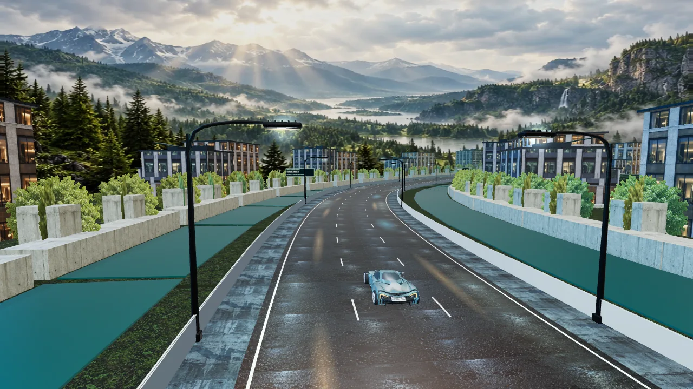

# Circuit handling — version 9

Twelve courses now have distinct 96-knot bend profiles, smooth elevation and banking. Harbor chicanes, alpine switchbacks, river esses, a city grid, ocean sweepers, solar rally roads, canyon hairpins, basalt slalom, canal bends, ice ridges, a reactor technical section and a descending skyway use the same course data in native rules, road geometry and HUD maps. Continuous road strips avoid gaps between rotated rectangular tiles. Vehicles, roadside buildings, lamps, projectiles and contact effects use the same road frame. Map thumbnails are actual rendered course captures.

The large reflective half-spheres have been removed. Commons Gardens uses layered research buildings with textured facades, entrance canopies, roof services and planted canal walks. Polar Array uses exposed antenna towers and directional panels. Both reuse the existing generated structure/facade atlases and instanced material pools.

## Contact design and references

This is a deterministic road-space arcade contact model, not a full 3D tire/suspension simulator. Contacts use swept boxes, relative velocities, vehicle mass, restitution, bounded tangential friction, penetration separation and off-center yaw impulses. Side scrapes exchange momentum while retaining traffic; heavy frontal or lateral closing consumes collision armor. Armor-free heavy crashes end the event. Rear-ended players are not penalized as if they initiated a frontal crash. Contact cooldowns prevent repeated damage from the same overlap. Braking cancels nitrous, can stop the vehicle, and reverse backs out of blocked lanes.

The implementation is original. The following primary project sources informed its design:

- [cannon-es RaycastVehicle](https://github.com/pmndrs/cannon-es/blob/master/src/objects/RaycastVehicle.ts): normal/side impulses, friction constraints and roll influence.
- [Bullet raycast vehicle](https://github.com/bulletphysics/bullet3/blob/master/src/BulletDynamics/Vehicle/btRaycastVehicle.cpp): relative velocity and constrained friction impulses.
- [JavaScript Racer](https://github.com/jakesgordon/javascript-racer/blob/master/v4.final.html): entering, holding and leaving bends, hills and linked esses.
- [Three.js spline example](https://github.com/mrdoob/three.js/blob/dev/examples/webgl_geometry_extrude_splines.html): coherent geometry frames along a continuous route.

The Street grid starts within reach, opponents preserve their momentum after contact, and normal Street/Pro lane selection leaves overtaking room. Elite retains deliberate blocking. Corner speed limits apply to both player and opponents. Successful events retain the 3–7 active minute window; a failed race may end earlier.

## Input and save compatibility

Colemak and Colemak-DH use A/S steer, R brake/drift, F fire, Q counter, Space nitrous and Z reverse. Bindings follow typed key labels, while held input releases use the physical code. QWERTY, arrows and custom bindings are supported. Settings pause local simulation, clear held inputs, reject conflicts and persist on the device. HUD/accessible shortcut labels update with the binding.

V9 has a new exact native application profile. V8 game.rs, session.rs and Cargo.lock remain frozen. The retained V8 verifier validates the complete original signed export before V9 carries its career into a fresh genesis. That proof is hashed into V9's initial state and included in later exports. V8 and V9 exports reject the other profile. An unfinished saved V8 event keeps its original physics; starting a new event explicitly makes the transition. Original storage is retained separately. Multiplayer and CKB settlement are not part of this release.

## Presentation budget

The renderer reuses road buffers, cached course tables, instanced scenery and shared texture atlases. Two physical street lights remain the maximum. Backing resolution stays capped at 3,686,400 pixels; reduced motion and the game-owned landscape rotation gate remain enabled. Physics runs at 30 Hz independently of rendering. Local browser measurements and production checks are recorded in `verification.md`.

