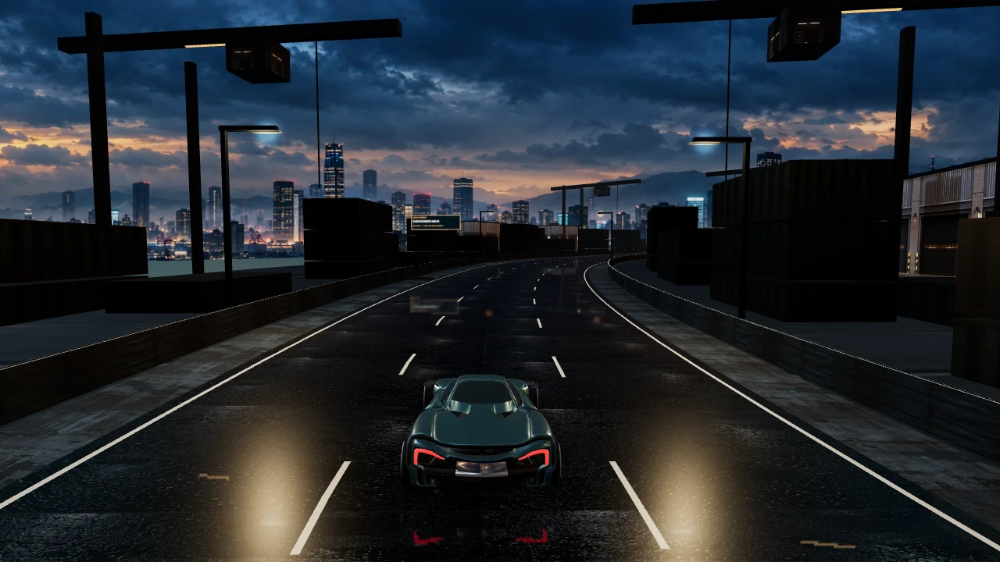
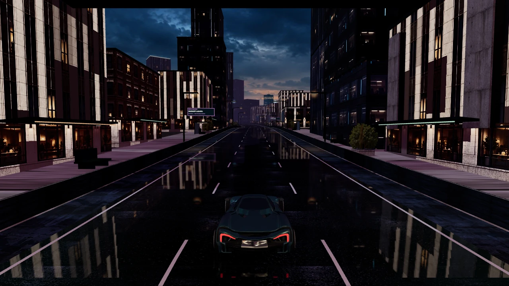

# NIGHTSHIFT 9.5 — Materials and lighting

The previous renderer combined detailed illustrated skies and facade photographs with simple foreground geometry, three synthetic reflection environments, a colour-atlas road and largely uniform material response. That mismatch made the scene read as disconnected layers. More texture detail alone cannot supply facade depth, correct surface normals or lighting consistent with the visible environment.

This is a presentation release. V9 rules, signed careers, native binaries and all retained V8/V7 identities are unchanged. The product remains a solo arcade prototype; the [completion audit](completion-audit-v94.md) still applies to handling, opponents, event variety and progression.

## Reference comparison

| Reference | Applicable lesson | Implementation and remaining limit |
| --- | --- | --- |
| [Three.js r180 car example](https://github.com/mrdoob/three.js/blob/r180/examples/webgl_materials_car.html) | HDR environment lighting, distinct paint/details/glass, physical clearcoat and controlled exposure | Local HDR probes, revised paint/clearcoat response and per-map lighting. The existing two licensed source bodies remain; no Ferrari assets were copied. |
| [Bruno Simon Folio 2025](https://github.com/brunosimon/folio-2025) | Lighting, weather, terrain, foliage and view composition need a coherent art direction and a resource budget | Separate route lighting palettes, atmosphere, cached instancing and optional effects. Its models, custom renderer and physics were not copied or claimed to be integrated. |
| [NFS Unbound art direction](https://www.ea.com/games/need-for-speed/need-for-speed-unbound/news/the-world-is-your-canvas) | Its expressive driving effects are grounded by realistically presented cars and environments | This release prioritizes surfaces and illumination. It does not claim NFS-level geometry, global illumination, reflection coverage or asset diversity. |

## Shipped changes

- Poly Haven's CC0 Asphalt 02 diffuse, OpenGL normal and roughness maps retain their shared 3 m surface scale. The road no longer derives height from its colour atlas. Metalness is zero; a spatial wetness mask varies roughness, surface darkening and normal response instead of making the whole road a uniform mirror.
- Three real HDR radiance sources replace the generic outdoor reflection cards. Two bounded local card sets augment the night/tunnel probes. Captured radiance peaks are limited before prefiltering because a separate directional light supplies the authored key. These are palette-matched illumination approximations, not reconstructed lighting from the finite background artwork.
- Twelve map-specific key, sky fill, ground bounce, fog, exposure and wetness presets replace illumination based on UI theme colours. Environment and key direction follow the world heading through bends. Daylight, snow, dusk, night and enclosed industrial scenes have distinct balances.
- Building masses use a shared small-bevel mesh. Facades have reduced metalness, material-specific roughness and restrained base darkening. These modest geometry/material changes do not replace the existing planar facade photography or supply baked architectural ambient occlusion.
- Two nearby physical street lights remain bounded. Additive light cards are weaker and fade with distance; they no longer overlay distant white pools without atmospheric attenuation. One shadow-free player headlamp illuminates nearby road surfaces and obstacles on dark routes.
- An HDR scene target feeds two quarter-dimension highlight-blur passes and a final AgX display transform. Two-sample target antialiasing and restrained edge filtering soften high-contrast edges. UI remains in the DOM and stays sharp. The high-precision scene receives its display transform once. There is no depth-of-field blur, chromatic aberration, animated grain or temporal history.
- Auto quality disables the optional HDR post pass when it sheds tier-zero work. Low quality uses the same PBR surfaces and illumination with direct rendering. Canvas and post targets follow the existing 3,686,400-pixel backing cap. Bloom targets use one sixteenth as many pixels as the scene target. The pass also falls back when floating-point colour targets are unsupported.
- New targets, probes and shaders participate in renderer disposal and context recovery. GPU timing includes reflection, scene and post work. Draw counters now count the whole frame, including auxiliary passes; compare those numbers with old main-scene-only counters cautiously.

## Asset budget and provenance

All new maps are served by NIGHTSHIFT; clients do not contact an asset CDN. The six files total 3,642,947 bytes. The three HDR sources were reduced from 4,316,069 bytes to 1,127,086 bytes by filtering linear radiance to 512×256 and RGBE/RLE encoding. Surface maps remain 1024×1024. Original and release hashes, sources and the CC0 link are in [lighting-assets-v95.json](lighting-assets-v95.json); numeric probe preparation is reproducible with `tools/prepare-lighting-probes.mjs` and the pinned original downloads. In-game credits link the new license notice.

## Verification scope

`tools/nightshift9-lighting-review.mjs` exercises real compiled shaders on all twelve maps, high/low/high quality transitions, the backing cap and inverse pointer transform at 1920×1080, 2560×1080, 2560×1440, 3840×2160, 844×390 and 390×844. Its isolated renderer uses synthetic display states; the portrait fixture tests rendering only, while the application acceptance suite tests the actual orientation gate. These images are not live gameplay or a human difficulty assessment.

The renderer now explicitly initializes race/garage display modes. Older standalone scenery fixtures could leave `previewMode` undefined and render the transparent garage floor over the road. New controlled before-images explicitly disable garage mode; new after-images assert that the garage stage is hidden. Initial tuning images affected by that fixture issue are diagnostic only.

Initial full-application performance attempts under heavy shared-machine load failed: a candidate sample measured 11 median FPS, and a subsequent unchanged 9.4 baseline measured 2 median FPS. Both are retained under ignored `artifacts/lighting-v95/`; they do not establish relative performance or a release success. See the final verification record for subsequent acceptance and performance evidence. No desktop or emulated-touch sample establishes physical-phone thermals or long-session memory behavior.

## Remaining visual work

The finite sky/background plates, simple terrain silhouettes, repeated crane/container structures, billboard vegetation, two base vehicle bodies and planar facade detail still limit visual quality. This release adds no screen-space ambient occlusion, temporal antialiasing, screen-space ray tracing or global illumination. Dedicated modular scene meshes, authored LODs and correct UV/PBR sets are still needed to close the asset-quality gap. Image generation can enrich appropriate artwork, but cannot replace these geometric and illumination requirements.

## Controlled visual comparison

Same 1280×720 camera and course position; synthetic render-only states, with garage mode explicitly disabled in both versions.

| 9.4 | 9.5 |
| --- | --- |
|  |  |
|  |  |

Machine-readable verification: [lighting-results.json](lighting-results.json).
