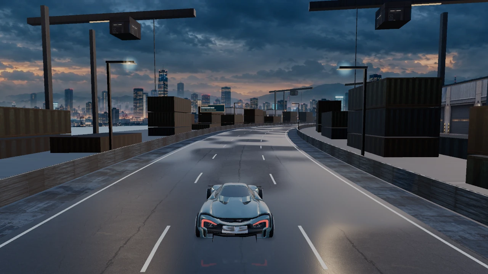
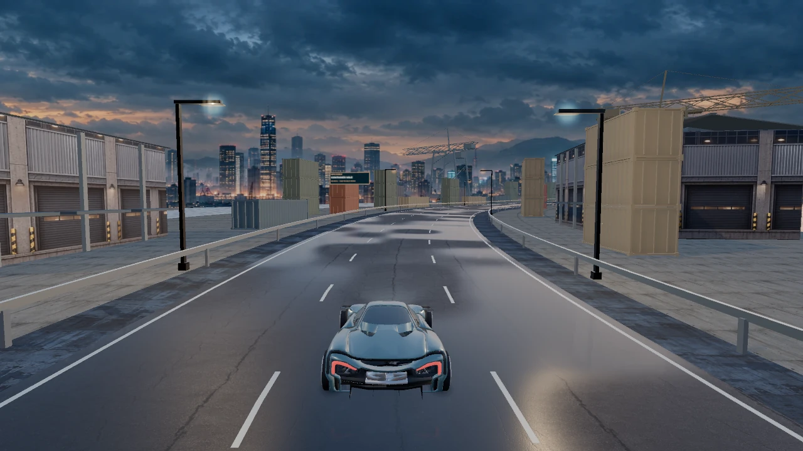
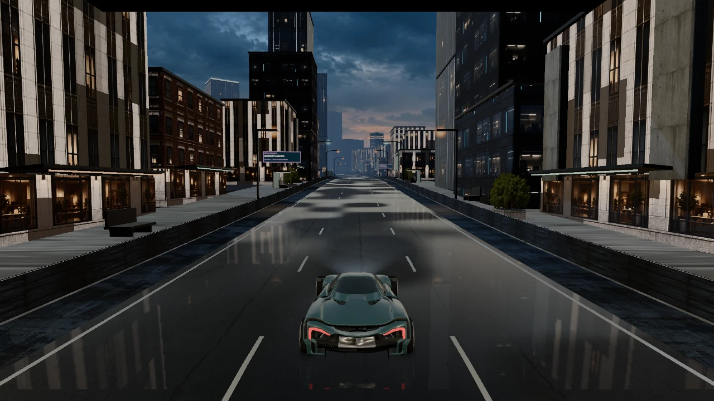
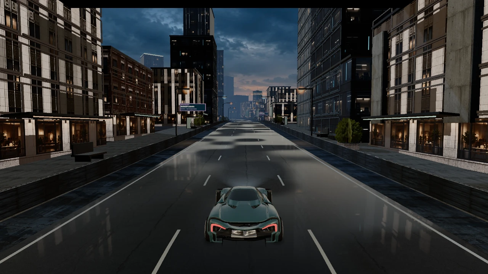
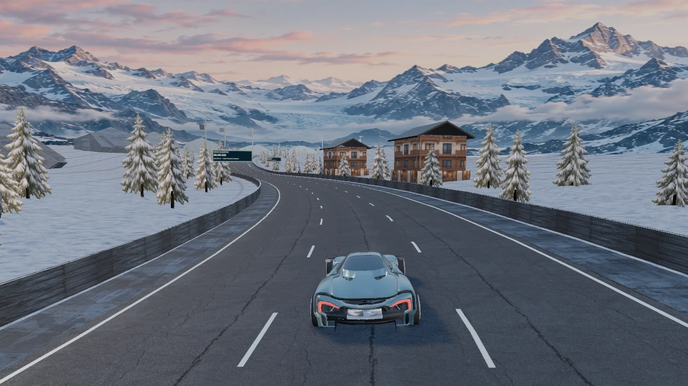
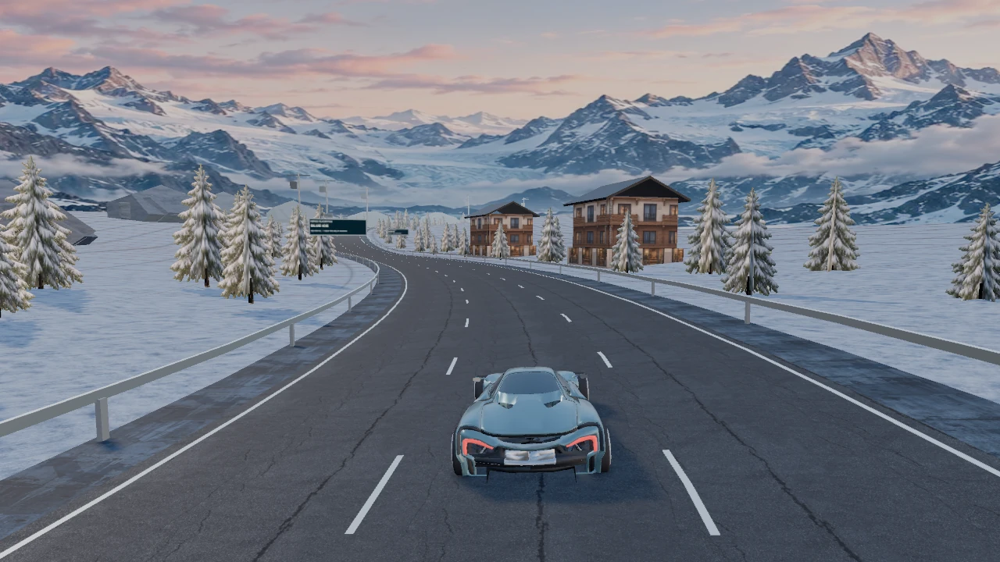

# NIGHTSHIFT 9.6 — District structure and depth

The 9.5 lighting pass exposed simple foreground shapes: wide box containers, suspended box cranes, flat facade detail and a metallic quay. This release rebuilds those scene components while retaining the exact V9 rules, application profile, native binaries and signed-career namespaces.

## Scene changes

- Nervos Harbour uses shared 20 ft and 40 ft container meshes with actual corrugations, corner frames, door seams and locking bars. Container proportions are 2.45×2.6 m with 6.05/12.2 m lengths. Painted steel uses restrained procedural wear rather than stretching the old cargo photograph over every face.
- New quayside cranes have braced legs, lattice booms, stay cables, a control cabin, hoist cables and a spreader. Their piers include support piles down into the water. Warehouses have sloped roofs, projecting canopies, framing and roof equipment. Stacks, yards, warehouse frontage and sparse cranes alternate across the existing 24 deterministic composition variants.
- Painted `NERVOS / RELAY FREIGHT / CKB` marks sit on cargo surfaces. These are world artwork, not gameplay panels or buttons. The setting remains fictional and off-chain; no settlement or multiplayer feature is introduced.
- City, campus and research buildings gain projecting floor bands, mullions and sills at close range. Facade texture dimensions now use a more consistent approximately 3 m floor cadence. The existing facade artwork is retained; this is relief geometry, not a complete interior or new building catalog.
- Harbour and urban sidewalk bands use rough, nonmetallic concrete with a dedicated world-metre texture mapping. The former metallic-quay material and its instance-oriented texture mapping were inappropriate for the continuous terrain strip. Water gains small view-correct ripple normals without a second reflection scene.
- Open-road districts use metal rails and posts instead of continuous opaque one-metre walls. Urban streets, gardens and the reactor retain their solid edges. Rail posts are anchored to the actual course grade and bank, including their longitudinal offset within each cached chunk. Container feet meet the quay level and crane feet meet the pier deck. Course coordinates, road width and native collision limits are unchanged.
- Existing foliage artwork is arranged into one shared three-plane mesh per tree. This supplies a fuller silhouette with fewer per-tree instance transforms than separate cards. Cutout foliage now participates in the existing bounded directional shadow pass; low quality keeps its shadow fallback.
- Gold ring collectibles are replaced by a small faceted Cell core and the existing transparent generated Cell artwork. They retain their native IDs, visibility colour, spawn positions and collection rules. Their smaller icon scale avoids covering the driving line. Wet-road reflection coverage and curvature transitions fade instead of switching across hard borders.

## Resource budget

The industrial geometry is authored in `nightshift9-industrial.mjs`; no new downloaded texture/model files are required. The only new raster allocation is a small local canvas stencil using the existing system font. All meshes share geometry/material pools. There are 38 world pools, below the existing 40-pool fixture budget, and every district template remains within the existing 40-part budget.

Container fittings and facade relief are restricted to 110 m at high quality and 64 m at the intermediate tier; low quality removes those optional pieces. Structural bodies and silhouettes remain. Changing quality invalidates the cached instance upload once; movement within a cached chunk does not rebuild it. Near details and pool counts are exposed in the engine review snapshot. Additional geometry is included in renderer disposal, including materials temporarily absent from the selected map.

## References and scope

The [Kenney industrial kit](https://kenney.nl/assets/city-kit-industrial) is a reference for modular variation and distinct industrial silhouettes. Its model files were not imported. The shared-mesh approach follows the [Three.js InstancedMesh contract](https://threejs.org/docs/pages/InstancedMesh.html); geometry merging and the renderer use the already credited MIT Three.js components. The new generator is original repository code, rather than a claim to have imported a photorealistic environment pack.

This release does not resolve the remaining gameplay gaps in the [completion audit](completion-audit-v94.md). It retains the two existing base vehicle bodies, finite background plates and cutout vegetation. It adds no global illumination, screen-space ambient occlusion or fully modeled building interiors.

## Verification

Eighty-six Node/host tests cover the unchanged gameplay and new geometry integrity, normal/UV validity, decorative clearance from the driving corridor, quality transitions and cached instance restoration. The road-station reference test now checks the declared metal-rail heights as well as the retained solid-wall presentation.

The scene fixture covers twelve maps and eighteen high/low/high resize/input cases at all six required sizes, without shader/browser errors. Those are synthetic render-only states, not human gameplay. Performance samples, staged/public application checks, replay preservation and exact served-file hashes are recorded in [district-results.json](district-results.json). Short desktop and emulated-touch samples do not establish physical-phone thermal or long-session performance, and no controlled speedup over 9.5 is claimed.

## Controlled scene comparison

The isolated camera, course position and state are the same 1280×720 fixture in each version.

| 9.5 | 9.6 |
| --- | --- |
|  |  |
|  |  |
|  |  |
